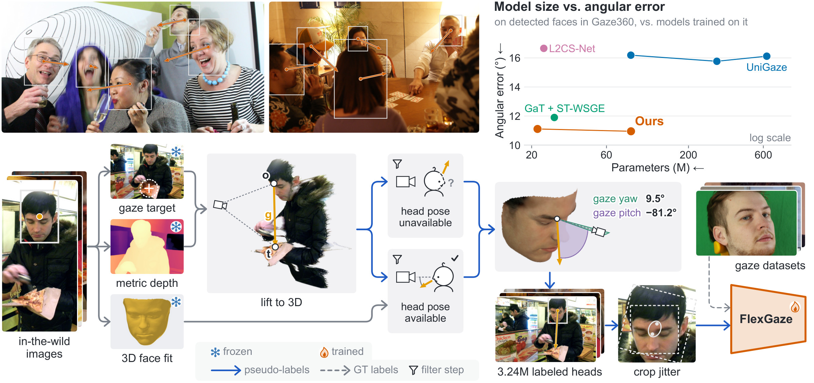

# FlexGaze: Weakly Supervised Gaze Estimation at Scale

[](https://ihp-lab.github.io/FlexGaze/)
[](https://arxiv.org/abs/2611.30012)
[](https://huggingface.co/datasets/ZongjianLi/FlexGaze)
[](https://huggingface.co/ZongjianLi/FlexGaze)

<p align="center">
  <a href="https://ihp-lab.github.io/FlexGaze/">
    <picture>
      <source media="(prefers-color-scheme: dark)" srcset="assets/teaser-dark.jpg">
      
    </picture>
  </a>
</p>

## Abstract

Most gaze estimation models are trained on data collected using specialized equipment. The limited diversity of subjects, scenes, and head poses in these datasets hinders generalization to new conditions. We present FlexGaze, a family of 3D gaze estimators pretrained with weak supervision from gaze labels (pseudo-labels) automatically generated from in-the-wild images. We use off-the-shelf models to predict 2D gaze targets and scene depth, then combine these predictions to generate 3D gaze labels for approximately 3.24 million head instances. At inference, FlexGaze predicts gaze from a head crop alone and can handle profile and rear views without requiring face detection or head pose estimation. We use data augmentation during training to improve robustness to variations in crop position and scale. Pretrained using only these generated gaze labels, FlexGaze generalizes to unseen benchmarks. After supervised fine-tuning on public gaze datasets, we evaluate FlexGaze on eight benchmarks under a unified evaluation protocol. Our models match or outperform publicly available gaze estimators with several times as many parameters on most benchmarks. We release our dataset of generated gaze labels, all trained models, and code via github.com/ihp-lab/FlexGaze.

## Repository layout

This repository holds the code. The models and the generated gaze labels are in the [model repository](https://huggingface.co/ZongjianLi/FlexGaze) and the [dataset repository](https://huggingface.co/datasets/ZongjianLi/FlexGaze).

- [`minimal-inference/`](minimal-inference/): the smallest complete code for running FlexGaze. Given an image, it finds the heads and returns a 3D gaze direction and a confidence (von Mises-Fisher concentration) for each of them, using only NumPy, OpenCV and ONNX Runtime.
- [`full-codebase/`](full-codebase/): the full FlexGaze framework, covering gaze label generation, training and fine-tuning, the evaluation toolkit, and inference. Coming soon.

The two parts do not depend on each other.

## License

This code is released under the USC Research License (see [`LICENSE`](LICENSE)).
Third-party components, the model weights and the dataset follow their own terms.

## Citation

```bibtex
@article{li2026flexgaze,
  title   = {FlexGaze: Weakly Supervised Gaze Estimation at Scale},
  author  = {Li, Zongjian and Soleymani, Mohammad},
  journal = {arXiv preprint arXiv:2611.30012},
  year    = {2026}
}
```
